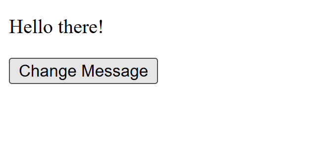
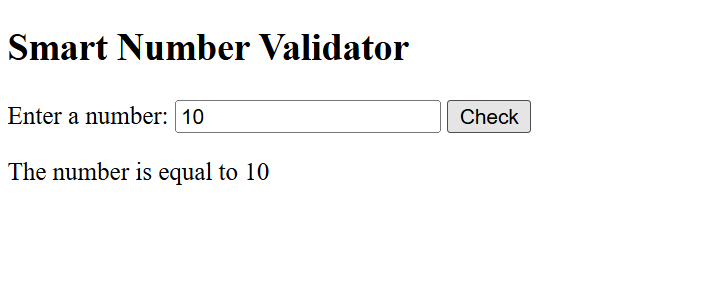
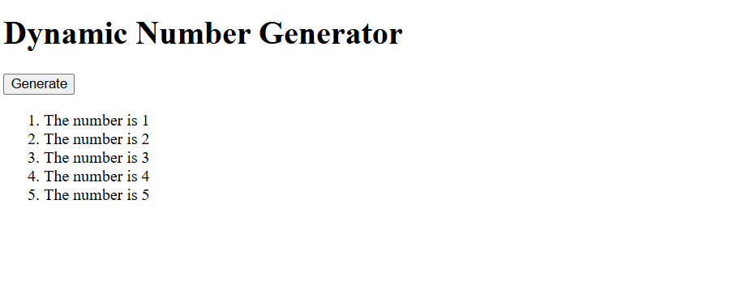

# BIC21203 Web Development
## Lab 4a: Client-Side Scripting (JavaScript)

### Student Information
- **Name:** IMAN NUR IZZAH BINTI MOHD RAFIZAN
- **Matrics No.:** AI250113
- **Section:** 7

### Introduction
This lab focuses on JavaScript functions, events, conditions, loops, and DOM manipulation. The purpose is to develop interactive web pages using JavaScript.

### Question 1: Interactive Text Changer
- Created a button that changes the paragraph text.
- Used `getElementById()` to select HTML elements.
- Used the `changeMessage()` function and `addEventListener()`.
- **Expected output:** "Hello there!" appears after clicking the button.

### Question 2: Smart Number Validator
- Created an input field for entering a number.
- Used the `checkInput()` function and `if...else if...else` statements.
- Validated empty, invalid, lower, higher, and equal-to-10 inputs.
- **Expected output:** An appropriate validation message is displayed.

### Question 3: Dynamic Number Generator
- Created a button to generate a numbered list.
- Used a `for` loop and DOM methods such as `createElement()` and `appendChild()`.
- Cleared existing list items before generating again to prevent duplicates.
- **Expected output:** The list displays numbers 1 to 5.

### How to Run
1. Download or clone this repository.
2. Open the project folder in Visual Studio Code.
3. Open each question's HTML file in a web browser.
4. Click the buttons and test the program outputs.

### Screenshots

### Question 1: Interactive Text Changer

### Question 2: Smart Number Validator

### Question 3: Dynamic Number Generator

### Reflection
This lab helped me understand how JavaScript makes web pages interactive. I learned to use functions, event listeners, conditional statements, and loops. I also practised manipulating HTML elements using DOM methods. Testing the programs helped me understand how JavaScript responds to user actions.

### Repository
GitHub Repository: https://github.com/imanizzah1702-beep/lab4a-javascript2.git

